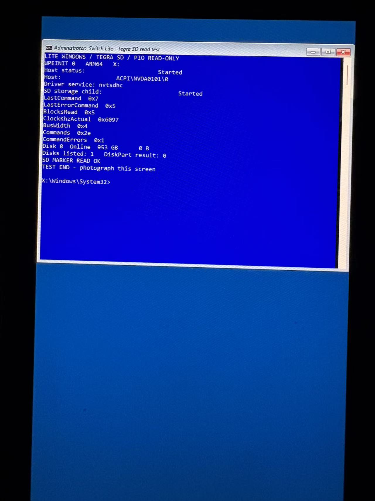

# Switch Lite HDH-001 WinPE read test

One physical Switch Lite (T210B01) reached the ARM64 Windows PE 10.0.22621.1 command prompt. In the external-slot test, WinPE started the nvtsdhc controller and its storage child, listed a 953 GB disk and read the expected marker from the SD filesystem. WinPE itself ran from X:. The captured clock was 24,727 kHz in 4-bit mode. The driver's snapshot also recorded one command error (command index 5). Only reads were tested.

## Reproduce the tested development build

1. Use the [WinX unified baseline](https://github.com/steck0714/winx/commit/4bbf2a87a571c21d464e3719bd26fc66f8cf1cc1) in a clean NintendoSwitchPkg checkout. Apply patches 01 through 06 in numerical order with `git -c core.whitespace=cr-at-eol apply <patch>`. The firmware patches recreate the lab boot path, including its marker, Windows loader path and read-only view of a hybrid MBR for the boot manager. Patch 06 applies to the vendored driver. The patches describe the integration used for the photo, including intermediate diagnostics.
2. The historical firmware build references [EfiFs v1.12 exfat_aa64.efi](https://github.com/pbatard/EfiFs/releases/download/v1.12/exfat_aa64.efi). Place it at `NintendoSwitchPkg/LiteSdTest/exfat_aa64.efi` and verify SHA-256 `629e567847ba028cb6ba1f75af12b1ace2094a6b1e70cddbfe1a99a82cdd0511`. The card volume used in the successful test was FAT32.
3. Follow WinX's edk2-stable202402 setup. Build RELEASE AARCH64 with GCC5 and `-D SWITCH_HEKATE=1 -D SWITCH_FB_ROTATE=2 -D SWITCH_EXCFB=1 -D SWITCH_ACPI_SD_NVTSDHC=1`. Package the generated FD with WinX's `Tools/make-bl33.py` and the firmware map. Place BL33 with the Hekate L4T BL31 in `switchroot/woa-lite-nvsd/`. The tested BL31 was from the [LineageOS nx_tab build](https://download.lineageos.org/devices/nx_tab/builds) dated 2026-11-01, SHA-256 `77b7f5c688934a4d077cd5f39ffaa57383de422652797fd2cdfad67acf41cda4`. Place the accompanying Hekate INI under `bootloader/ini/`.
4. Build the patched `WindowsDrivers/drivers/Tegra210Sdhc` with the accompanying build-miniport.sh (LLVM, ARM64 WDK/SDK 10.0.26100 headers and libraries). Generate and sign the driver catalog and SYS with a local test certificate. Add its public certificate to the test WinPE's machine Root and TrustedPublisher stores, then stage the signed package in the offline 22621.1 ARM64 WinPE image with DISM. Install the accompanying startnet.cmd as Windows/System32/startnet.cmd in that WIM. [Microsoft WDK](https://learn.microsoft.com/en-us/windows-hardware/drivers/install-the-wdk-using-nuget) · [DISM driver servicing](https://learn.microsoft.com/en-us/windows-hardware/manufacture/desktop/add-and-remove-drivers-to-an-offline-windows-image?view=windows-11)
5. Use your own [Microsoft ARM64 ADK WinPE media](https://learn.microsoft.com/en-us/windows-hardware/get-started/adk-install#other-adk-downloads). On the FAT volume place the ARM64 boot manager, resources, fonts and a dedicated BCD under `EFI/LiteNV/`, the SDI at `boot/boot.sdi` and the serviced WIM at `sources/nvsd.wim`. In the copied BCD, set the default loader's device and osdevice to the RAM disk backed by `[boot]\sources\nvsd.wim`, keep the original SDI RAM-disk options and enable testsigning on that loader entry. Create `switchroot/woa-lite-winpe/MEDIA.ID` containing the ASCII text `SWITCH-LITE-WINPE-22621-R1` followed by one LF. The UEFI and the WinPE script independently check this file.
6. From Hekate select **Lite Windows Tegra SD**. The WinPE script enumerates the controller and storage child, runs DiskPart's list disk command, and checks the marker on an external volume. The expected final line above TEST END is **SD MARKER READ OK**.

The earlier inbox-driver test enumerated an NVDA0212 SD host with sdbus.inf, but DiskPart listed zero disks. The dedicated-driver test changed both the ACPI identity and the driver. The comparison does not isolate the original failure to a single cause. SD writes, persistence after a power cycle and a full installed OS were outside the photographed test.
