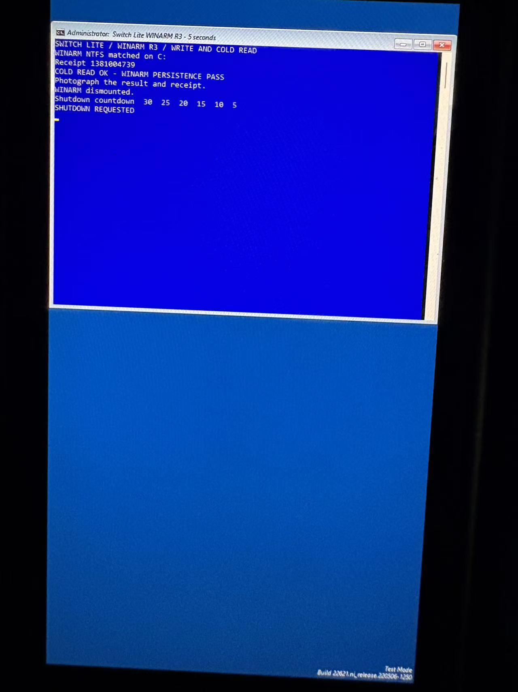

# Switch Lite HDH-001 · WINARM R3

On one HDH-001 running ARM64 WinPE 10.0.22621.1, the R3 test wrote a 4 KiB file to a dedicated 80 GiB NTFS partition. After shutdown and another Hekate boot it matched WINARM on C:, verified all 64 records and read back receipt **1381004739**. The photograph shows the cold-read pass and the subsequent volume dismount. Windows PE itself booted from a RAM disk. The scope of this test is one card and one console.



## What changed

R2 corrected the driver package signature for the firmware's cold-start clock. The SD host then started on the console, but its storage child timed out. The write filter in R2 rejected ACMD42 during four-bit initialization. R3 accepts a no-data DAT3 pull-up command only after an acknowledged CMD55. A standard lock-card CMD42 or a data-out variant is rejected. A replay of the ARM64 Windows 22621 bus-width routine against the miniports returned write-protected at command 42 in R2 and completed the sequence through ACMD51 in R3. R3 also checks that a request is still outstanding before handling a completion.

The firmware checks the disk geometry, hybrid MBR, primary GPT CRCs, target partition and NTFS boot sector. The Windows miniport reports only the WINARM entry in its returned MBR buffer. To issue a PIO block write, it requires SDXC block addressing, the expected MBR and NTFS identities, and an entire request inside the configured partition. It checks continuation transfers and clears the observed identity when resetting or losing the card. See the [miniport](https://github.com/ruje0504-2/Windows-for-Switch-Drivers/blob/hdh001-winarm-bounded-write/drivers/Tegra210Sdhc/src/nvtsdhc.c) and the [firmware checks](../../Library/PlatformBootManagerLib/WinPeGptView.c).

## Generate the card-specific inputs locally

The firmware, miniport, build manifest and test script in this tree are for the R3 experiment. The original card's identifiers are supplied at build time. The generator opens a saved **regular whole-card image** read-only. It requires the tested layout: 512-byte sectors, primary GPT at LBA 1 with eleven 128-byte entries at LBA 2, GPT slot 11 named WINARM and the same 80 GiB basic data partition in hybrid MBR slot 4. It verifies the primary GPT CRCs, bounds, NTFS geometry and agreement with the MBR.

From the checkout root, using a new output directory:

```sh
target=docs/hdh001-winarm-r3/generated
python3 WindowsDrivers/drivers/Tegra210Sdhc/winarm/configure-target.py /path/to/saved-card.img "$target"
cp "$target/winarm-target.h" WindowsDrivers/drivers/Tegra210Sdhc/src/
```

The generated inputs belong to that card. The same header is used by BL33 and the SD driver. The generated startnet.cmd includes the matching NTFS serial. With the local test image, both files were reproduced byte for byte from the hardware build. The unsigned miniport rebuilt from this tree matched the one used for signing (SHA-256 `c6364cd4d45a57c9c109463141d21abc7161a277b2a2d1e4ae92dc7276ea1531`). The rebuilt BL33 passed the upstream stub and entry-point checks. Its whole-file hash differs from the originally packaged BL33.

## Build and boot

1. Check out this branch as `NintendoSwitchPkg`. For edk2-stable202402, the GCC5 target, the pinned EfiFs dependency and compatible BL31, follow steps 2–3 of the [read-only build recipe](https://github.com/ruje0504-2/winx/blob/e50754107c5db2a8a93ffdebc4da7fceb843c2c4/docs/hdh001-lab/README.md). Build RELEASE AARCH64 with `-D SWITCH_HEKATE=1 -D SWITCH_FB_ROTATE=2 -D SWITCH_EXCFB=1 -D SWITCH_ACPI_SD_NVTSDHC=1`. Use the upstream BL33 packer and map, then put BL31 and BL33 under `switchroot/woa-lite-winwr/`. Place the [Hekate entry](woa-lite-winwr.ini) under `bootloader/ini/`.
2. Build the [Tegra210Sdhc sources](https://github.com/ruje0504-2/Windows-for-Switch-Drivers/tree/hdh001-winarm-bounded-write/drivers/Tegra210Sdhc/) with [build-miniport.sh](../hdh001-lab/build-miniport.sh), LLVM and the ARM64 WDK headers and libraries. Use a relative source path: `sh docs/hdh001-lab/build-miniport.sh WindowsDrivers/drivers/Tegra210Sdhc /path/to/output`. The INF is version 0.3.2.4 and matches ACPI NVDA0101. Put the final INF (Windows CRLF), SYS and [driver.cdf](driver.cdf) together. Sign the SYS with your development certificate, run `makecat -v driver.cdf` on those exact files, then sign the resulting CAT. Check the embedded signature and both catalog members with SignTool at the firmware's cold-start time. Add the **public certificate** to the test WinPE's machine Root and TrustedPublisher stores and inject the signed driver into your own ARM64 22621.1 WinPE image with DISM. [Microsoft driver signing checks](https://learn.microsoft.com/en-us/windows-hardware/drivers/install/verifying-the-signature-of-a-test-signed-driver-file)
3. Place the generated startnet.cmd at `Windows/System32/startnet.cmd` in the WIM. Use `EFI/LiteWR/` for the boot manager and its private BCD, `sources/nwrt.wim` for the serviced image, and `boot/boot.sdi` for the RAM-disk SDI. Set the default BCD entry's device and osdevice to the RAM disk backed by `[boot]\sources\nwrt.wim`, enable testsigning on that entry, and use the existing `switchroot/woa-lite-winpe/MEDIA.ID` marker described in the [baseline media recipe](https://github.com/ruje0504-2/winx/blob/e50754107c5db2a8a93ffdebc4da7fceb843c2c4/docs/hdh001-lab/README.md).
4. In Hekate select **Lite WINARM Write Test**. On the first boot record the receipt next to **WRITE + FLUSH + READ OK** and let the machine shut down. Boot the same entry again. **COLD READ OK - WINARM PERSISTENCE PASS** and the same receipt indicate a successful cold read. The test creates `\LITE-WINARM-V1\PERSIST.TXT` on the matched NTFS volume. The receipt above is specific to the photographed run.
