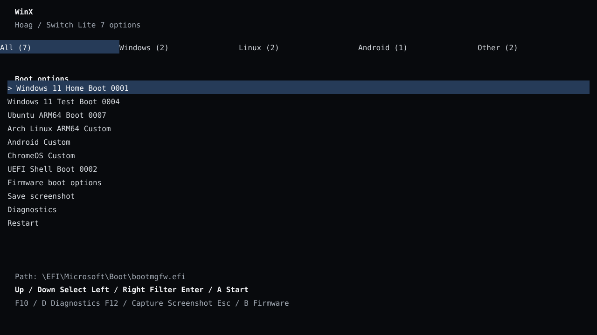

# WinX の複数 OS ブートメニュー



この図はレイアウト案で、実機画像ではありません。メニューは既存の UEFI `Boot####` 項目と、任意の `entries.ini` に書いた個別 EFI アプリを並べます。同じ OS の別インストールも項目ごとに残ります。OS の自動判定やディレクトリ全走査はしません。

## 既存 Boot#### 項目

ファームウェアにすでに登録されている Boot#### を読み取り、説明と番号を表示します。エントリーを選ぶとその項目だけを起動します。メニューは項目の再検出を呼び出さず、Boot#### や BootOrder を新規作成・更新・削除しません。別々の ESP や異なる EFI パスを持つ Windows、Linux、Android のインストールは、別の Boot#### として登録されていれば個別に選べます。

説明に含まれる OS 名から Windows / Linux / Android / Other のフィルターを選びます。名前を判定できない既存項目は Other に入ります。フィルターは表示だけを変え、起動対象のファイルや設定は変更しません。

同じOSを複数入れる場合は、`Windows 11 Home / SD`、`Windows 11 Test / USB`、`Ubuntu 24.04 / internal`のように、版や格納先が分かる名前を付けてください。項目名の版情報で重複を区別する systemd-boot の考え方を参考にしています。選択行の下に、その項目のEFIパスを表示します。

## 任意の EFI 項目を追加

各 Simple File System ボリュームに、次のファイルを置けます。

```text
\bootloader\res\winx\entries.ini
```

書式は `表示名|OS分類|同じボリューム内の EFI パス` です。

```ini
# 表示名|windows / linux / android / other|ボリュームルートからのパス
Windows 11 Home|windows|\EFI\Microsoft\Boot\bootmgfw.efi
Windows 11 Test|windows|\EFI\Win11-Test\bootmgfw.efi
Ubuntu 24.04 ARM64|linux|\EFI\ubuntu\grubaa64.efi
Arch Linux ARM64|linux|\EFI\Arch\grubaa64.efi
Android test|android|\EFI\Android\bootaa64.efi
Custom EFI OS|other|\EFI\CustomOS\bootaa64.efi
```

例のパスは配置を示すだけです。実際に存在する AArch64 EFI アプリのパスへ置き換えてください。各パスは `entries.ini` と同じボリュームに必要です。パスの区切りには `\` を使い、`.efi` で終わるファイルを指定します。相対パス、`.` / `..`、存在しないファイル、ディレクトリ、誤った分類の行は読み飛ばします。

読み込み上限は 1 ボリュームあたり 64 KiB、合計最大 64 項目です。現在の形式はASCII文字のみです（日本語表示名やUTF-8文字を含む行は未対応）。読込対象は決め打ちした 1 ファイルだけで、再帰スキャンしません。EFI ファイルの存在確認とメニュー設定の読込は `EFI_FILE_MODE_READ` で行います。項目はメモリ上の一時ロードオプションとして起動し、Boot#### / BootOrder に保存しません。EfiFs が公開する読み取り専用ボリュームもメニュー設定の読込元にはできますが、設定を保存する場所にはなりません。

スクリーンショットはこの設定とは別機能で、ユーザーが要求した時だけリムーバブル書込可能 FAT へ保存します。診断画面はプロトコルと構成の存在を読むだけで、ハードウェア負荷試験や設定書込をしません。

## 対応範囲

- **Windows 複数インストール:** 別 ESP / EFI パスの `bootmgfw.efi` を複数登録できます。BCD がどの Windows を選ぶかは各 Windows ESP の構成によります。
- **ARM64 Linux 複数インストール:** 各ディストリビューションの EFI GRUB / shim などを個別登録できます。その先のカーネル、DTB、initramfs、ストレージ・画面ドライバーはディストリビューションと機種別の準備が必要です。
- **Android:** AArch64 EFI ローダーが用意され、その起動契約が当該端末の構成に合う場合に限り項目として起動できます。登録だけでは Android カーネルや Android ドライバーを提供しません。
- **ChromeOS / 自作 OS:** ARM64 EFI アプリとして起動できるローダーが存在する場合に限り登録できます。ChromeOS の一般的な Switch 起動経路が確認済みという意味ではありません。
- **iPadOS / XNU:** EFI アプリへの登録は可能でも、それだけで XNU、APFS、Secure Boot、SEP、タッチや GPU が起動するわけではありません。WinX から起動できる XNU ローダーは未検証です。

この仕組みは EFI アプリの選択メニューです。各 OS の起動成功、マルチブート時の電源状態、Windows/Linux/iPadOS のドライバー対応はそれぞれ別に確認します。Windows ドライバーと UEFI ドライバーの現状は[ドライバー不足点検](driver-gap-audit-ja.md)、OS ごとの先行調査は[ARM64 Linux](multiboot/arm64-linux-ja.md)と[iPadOS/XNU](multiboot/ipados-xnu-ja.md)を参照してください。

## 操作

上下キーで項目を移動し、左右キーで OS 分類を切り替えます。Enter または Joy-Con の A で起動します。タッチ / マウスは項目を選び、F10 / D または Joy-Con の − で読み取り専用診断を開きます。F12 / Capture は画面保存を要求し、ESC / B は UEFI ファームウェアの登録済み起動項目を開きます。Joy-Con 操作は入力プロトコルの提供ドライバーがある場合のみ使えます。現在の WinX ソースにはメニュー側の読取経路はありますが、Joy-Con UEFI ドライバー本体はまだありません。

実装は [SwitchBootMenu.c](../Library/PlatformBootManagerLib/SwitchBootMenu.c) と [SwitchBootEntries.c](../Library/PlatformBootManagerLib/SwitchBootEntries.c) にあります。壁紙は WinX 専用の `bootloader/res/winx/menu.bmp` から読み込み、Hekate / Nyx の壁紙設定とは別です。UEFI Shell を選ぶと画面を黒に戻してから渡します。

## 参考にした一次ソース

- [EDK II UefiBootManagerLib](https://github.com/tianocore/edk2/blob/edk2-stable202608/MdeModulePkg/Include/Library/UefiBootManagerLib.h) — Boot#### ロードオプションの型とブート API。
- [EDK II UiApp FrontPage](https://github.com/tianocore/edk2/blob/master/MdeModulePkg/Application/UiApp/FrontPage.c) — GOP解像度とコンソールのテキストモードを扱う例。
- [Hekate / Nyx](https://github.com/CTCaer/hekate/blob/master/nyx/nyx_gui/nyx.c) — 複数エントリーとタッチ操作を持つ Switch 用ランチャーの実装例。WinX はそのソースをコピーしていません。
- [rEFInd 設定形式](https://github.com/RefindPlusRepo/rEFInd/blob/master/docs/refind/configfile.html) — 複数 EFI ローダーを明示的な項目として列挙する考え方。
- [systemd-boot](https://github.com/systemd/systemd/blob/main/docs/BOOT.md) — 設定ファイルごとの個別項目、title/version表示、キーボード中心の一覧UI。
