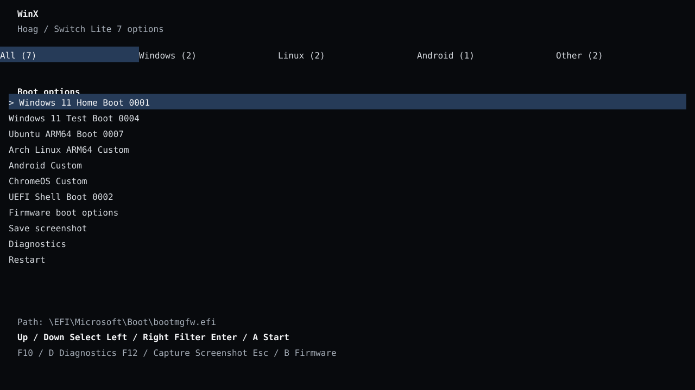

# WinX UEFI画面のカスタマイズ



この見本は横向きのWinXブートメニュー案です。項目名は例で、実機画像ではありません。1列の一覧、控えめな選択色、画面下の起動パスと短いキー案内に整理しました。装飾的なカード、大きなOSバッジ、長い説明文を避け、UEFIの固定幅コンソールに合わせています。

## GitHub上の実装を参考にした設計

| 参考実装 | 見た点 | WinXへ反映した考え方 |
|---|---|---|
| [Hekate / Nyx](https://github.com/CTCaer/hekate) | Switch向けのタッチ・Joy-Con対応、テーマ、ランチャー表示。背景画像・アイコンの形式も公開されています。 | Switch固有の入力とテーマを意識します。ただし、Hekateの描画や入力コードをWinXへコピーせず、UEFIのプロトコルと既存コンソールに合わせます。 |
| [rEFInd](https://github.com/RefindPlusRepo/rEFInd/blob/master/docs/refind/configfile.html) | OS/ローダーごとの表示、起動項目の補助メニュー、複数ローダーの扱い。 | OS分類に加え、選択中のBoot番号・EFIパスを表示し、同一OSの別バージョンを個別項目として見分けられるようにします。 |
| [systemd-boot](https://github.com/systemd/systemd/blob/main/docs/BOOT.md) | 設定ファイルごとに明示したエントリーを並べ、title/versionで複数環境を区別する軽量な一覧とキーボード操作。 | アイコンの有無で起動可否が変わらないテキスト一覧を基本にし、明示登録された項目だけを扱います。ディレクトリ全体の探索はしません。 |
| [Limine](https://github.com/limine-bootloader/limine/blob/v12.x/CONFIG.md) | 一覧と短いキー案内に加え、グラフィカル端末ではフォント、サイズ、倍率、字間を設定できます。 | WinXの現在の文字メニューはEDK II SimpleTextOutを使うため、文字の形と大きさはUEFIコンソール側が決めます。今回はフォントを偽装せず、文言と配置を固定幅表示に合わせます。 |
| [EDK II UiApp](https://github.com/tianocore/edk2/blob/master/MdeModulePkg/Application/UiApp/FrontPage.c) | GOP解像度とテキストモードを確認して、ファームウェア画面の表示を調整する方法。 | 固定の画面サイズを前提にせず、現在のUEFIテキスト列数・行数へ合わせます。画像が使えない時も文字一覧で起動操作を続けられるようにします。 |

[hekate-cnx fork](https://github.com/CostelaCNX/hekate-cnx) も確認しました。テーマ色、背景色、項目列数などNyxの設定を公開していますが、WinXに移すべき別系統のUEFIメニュー実装は見当たらなかったため、Nyx本体と同じく設計参考として扱います。

この比較から、WinXはsystemd-bootとLimineの簡潔な一覧を土台に、rEFIndの項目識別とHekateのSwitch入力・テーマ要望を加える方針です。Limineのような独自フォント表示にはGOP描画の文字レンダラーが必要です。現在はUEFI標準フォントを使い、固定幅表示で崩れにくい文字数と配置にしています。これは公開ソースから導いた設計判断で、WinXの実機表示や入力を確認した結果ではありません。

WinX専用の画像は、SDカードの次のフォルダーから読み込みます。

```text
bootloader/
└── res/
    └── winx/
        ├── uefi.bmp
        ├── uefi-00.bmp       (任意のアニメーション1枚目)
        ├── uefi-01.bmp       (任意)
        ├── menu.bmp
        └── os/
            ├── windows.bmp
            ├── linux.bmp
            └── ipados.bmp
```

このフォルダーだけを参照します。Hekateの`bootloader/res/background.bmp`やHekateの壁紙設定は読み込まず、変更もしません。画像が見つからないか形式が未対応ならWinXの標準表示を使います。

## WinXのUEFI起動画面

`uefi.bmp`は黒背景の中央に表示するロゴです。BMPは非圧縮の24-bitまたは32-bitで、画面より大きい画像は縦横比を保って縮小します。小さい画像は原寸で表示します。Windowsへ渡すBGRTロゴもロゴ部分の画像領域と画面上の位置に合わせて登録します。

短いアニメーションを使う場合は、`uefi-00.bmp`から`uefi-07.bmp`までを連番で置きます。最初に欠けた番号で終わり、最大8枚です。静止画だけならアニメーション待ち時間はありません。連番を使った場合はフレーム間に80 msを入れ、画像読み込み・描画時間が加わります（明示的にフレームを置いた場合だけ）。

## WinXブートメニュー

`menu.bmp`は画面全体に合わせて拡大・中央トリミングし、文字メニューの背景として使います。読み込みはメニュー表示時に一度だけ行います。背景全体はメニューを開いた時、診断画面から戻る時、OS起動から戻った時に描きます。上下移動などのたびに背景画像をコピーし直さず、変更された文字行だけを更新します。`menu.bmp`がない場合は黒背景です。

メニューは現在のUEFIコンソール幅を使った1列一覧です。Windows / Linux / Android / Otherの分類、Boot番号、ユーザーEFI項目、選択したEFIパスを表示し、読み取り専用診断画面を備えます。OS名の自動スキャンはせず、既存Boot####と任意の`entries.ini`を使います。追加方法と制限は[複数OSブートメニュー](winx-multiboot-ja.md)を参照してください。

UEFI Shellを起動するときは画面を黒に戻してからShellへ渡します。WinXの壁紙とロゴをShell画面へ残しません。

## OS起動時のロゴ

OSを選んだ直後に、対応するファイルを黒背景の中央に表示し、Boot Graphics Resource Table（BGRT）へロゴの領域と位置を登録します。

| メニュー項目名に含まれる文字 | 静止画 | 任意の連番 |
|---|---|---|
| `Windows` / `WinARM` | `os/windows.bmp` | `os/windows-00.bmp`〜`os/windows-07.bmp` |
| `Linux` / `GRUB` / `L4T` / `Ubuntu` / `Debian` | `os/linux.bmp` | `os/linux-00.bmp`〜`os/linux-07.bmp` |
| `iPadOS` / `iOS` / `XNU` | `os/ipados.bmp` | `os/ipados-00.bmp`〜`os/ipados-07.bmp` |

OS個別の画像がなければWinXのUEFIロゴへ戻します。これはOSへ制御を渡す前に見せるロゴです。WindowsがBGRTの表示を採用するかはWindowsビルドとSwitch側の表示切替に依存し、実機確認が必要です。Linuxがカーネル起動後に表示するテーマはLinux側のinitramfs/Plymouthで設定します。iPadOSの起動ロゴをUEFIから変更できるとは扱いません。

この処理はUEFI段階だけです。BGRTは起動中に表示した画像の位置・画像データをOSへ渡すACPIテーブルです。MicrosoftはWindows起動中にBGRTのOEMロゴを使う構成を説明していますが、Switchの表示切替や対象Windowsビルドでも引き継がれるかは実機確認が必要です。[ACPI BGRT仕様](https://uefi.org/specs/ACPI/6.5/05_ACPI_Software_Programming_Model.html#boot-graphics-resource-table-bgrt) / [Microsoft Windows boot screen components](https://learn.microsoft.com/en-us/windows-hardware/drivers/bringup/boot-screen-components)。Linuxでカーネル起動後に出すテーマはLinux側のinitramfs/Plymouthで設定します。[Plymouth](https://wiki.freedesktop.org/www/Software/Plymouth/)。iPadOSの起動ロゴをUEFIから変更できるとは扱いません。
